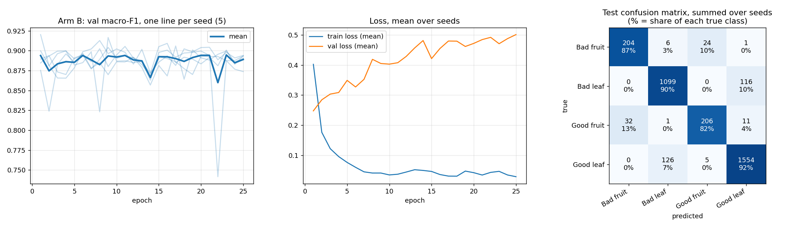
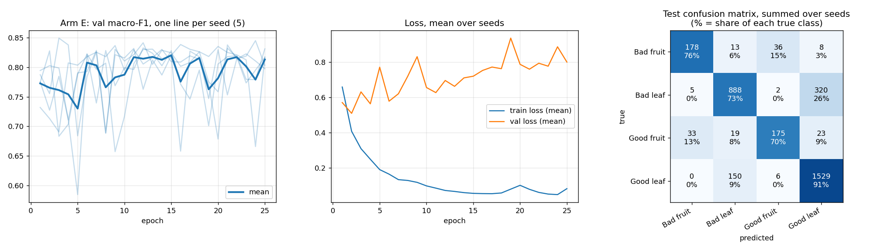

# Dragon fruit & leaf health classifier

A four-class image classifier (Bad fruit, Bad leaf, Good fruit, Good leaf) built as a controlled experiment:
a small CNN trained from scratch versus ResNet18 with and without ImageNet pretraining, five seeds per
configuration, plus an audit of the dataset itself. This is project 1 of a six-project deep learning portfolio
series, covering training mechanics and transfer learning.

**Headline result.** Pretrained ResNet18 at 224 px reaches a test macro-F1 of **0.884 ± 0.013** (mean ± SD over
5 seeds, 677 test images), against **0.799 ± 0.013** for the from-scratch baseline, a gain of 0.085. On the
test images that have no near-duplicate in the training set ("twin-free", see [Data quality](#data-quality)),
the same model scores **0.893 ± 0.012** and the ranking of all arms is unchanged.

> **About the test set.** The 677 test images come from the repaired train/val/test split shipped in the
> dataset's `cleaned` folder, not from Kaggle's original split (94–99% of each test class kept its original split).

## Contents

- [Experiment design](#experiment-design)
- [Results](#results)
- [Data quality](#data-quality)
- [What was not tested](#what-was-not-tested)
- [Reproducing the experiments](#reproducing-the-experiments)
- [Demo app](#demo-app)
- [Repository layout](#repository-layout)

## Experiment design

**Data.** Dragon fruit and leaf images from Bangladesh ([Kaggle](https://www.kaggle.com/datasets/ohmahler91/dragon-fruit-and-leaf-dataset-from-bangladesh), uploaded by ohmahler91), folder `archive/cleaned`.
Images are not included in this repository.

| Class | Train | Val | Test | Total |
|---|---:|---:|---:|---:|
| Bad fruit | 198 | 46 | 47 | 291 |
| Bad leaf | 1049 | 242 | 243 | 1534 |
| Good fruit | 198 | 50 | 50 | 298 |
| Good leaf | 1364 | 336 | 337 | 2037 |
| **Total** | 2809 | 674 | 677 | 4160 |

The largest class is about 7× the smallest. Fruit classes are about 14% of the images but half of the
macro-F1, which is why macro-F1 (not accuracy) is the metric.

**Protocol.** Adam, batch size 32, 25 epochs, ImageNet normalisation, no augmentation, no class weighting.
The checkpoint is chosen by validation macro-F1, and the test set is evaluated once per run with that checkpoint.
Seeds 0–4 for every arm. Runs trained on resized JPEG copies of the dataset
(see [`make_resized_cache.py`](make_resized_cache.py)) on a free Colab T4 GPU: about 146 s per run at 128 px
and 322 s at 224 px.

**Arms.** Each arm differs from a neighbour in one factor (weights, learning rate or resolution):

| Arm | Model | Weights | Input | Learning rate |
|---|---|---|---|---|
| baseline | SimpleCNN (4 conv blocks 32→64→128→256, global average pooling, linear head) | scratch | 128 px | 1e-3 |
| A | ResNet18 | ImageNet | 128 px | 1e-4 |
| B | ResNet18 | ImageNet | 224 px | 1e-4 |
| C | ResNet18 | scratch | 128 px | 1e-3 |
| D | ResNet18 | ImageNet | 128 px | 1e-3 |
| E | ResNet18 | scratch | 128 px | 1e-4 |

## Results

Test macro-F1, mean ± SD over 5 seeds. "All test" is the full 677-image test set; "twin-free" keeps the
496 test images with no near-duplicate in train (cosine similarity < 0.98).

| Arm | Weights | Input | LR | All test (n=677) | Twin-free (n=496) |
|---|---|---|---|---|---|
| B | pretrained ResNet18 | 224 px | 1e-4 | **0.8840 ± 0.0126** | **0.8933 ± 0.0120** |
| A | pretrained ResNet18 | 128 px | 1e-4 | 0.8639 ± 0.0034 | 0.8670 ± 0.0035 |
| D | pretrained ResNet18 | 128 px | 1e-3 | 0.8245 ± 0.0126 | 0.8249 ± 0.0126 |
| baseline | SimpleCNN, scratch | 128 px | 1e-3 | 0.7992 ± 0.0125 | 0.7984 ± 0.0140 |
| E | ResNet18, scratch | 128 px | 1e-4 | 0.7916 ± 0.0081 | 0.7825 ± 0.0133 |
| C | ResNet18, scratch | 128 px | 1e-3 | 0.7764 ± 0.0385 | 0.7793 ± 0.0358 |

The seed-to-seed noise floor is about 0.013, so differences much smaller than that should not be read as real.

### What each factor contributed

Difference in test macro-F1, and the same difference divided by its standard error (z).

| Comparison | Difference | z |
|---|---:|---:|
| Pretraining alone (A − E, lr 1e-4) | +0.0723 | 18.4 |
| Learning rate for the pretrained model, 1e-4 vs 1e-3 (A − D) | +0.0395 | 6.8 (p ≈ .0015) |
| Resolution, 224 vs 128 px (B − A) | +0.0201 | 3.4 (p ≈ .021) |
| Learning rate for the scratch ResNet, 1e-4 vs 1e-3 (E − C) | +0.0152 | 0.9 |
| Scratch ResNet18 vs SimpleCNN (E − baseline) | −0.0076 | −1.1 |
| D − C (pretraining at lr 1e-3) | +0.0481 | 2.7 (p ≈ .046) |
| Everything combined (B − baseline) | +0.0848 | 10.7 |

Earlier experiments on the SimpleCNN alone: batch normalisation +0.004 (no measurable effect), dropout (no
measurable effect), and 128 → 224 px +0.013 (1.5 SE, not significant).

### Per-class F1 (all test, mean over 5 seeds)

| Arm | Bad fruit | Bad leaf | Good fruit | Good leaf |
|---|---:|---:|---:|---:|
| baseline | .772 | .816 | .725 | .884 |
| E | .787 | .777 | .744 | .858 |
| C | .777 | .756 | .719 | .853 |
| D | .805 | .838 | .771 | .884 |
| A | .858 | .854 | .850 | .893 |
| B | .866 | .898 | .849 | .923 |

- Pretraining helps all four classes (A − E: +.071 / +.077 / +.106 / +.035), most on the fruit classes.
  Compared with the baseline, 82% of arm A's gain is on fruit, because a scratch ResNet is slightly worse than
  the SimpleCNN on leaves.
- Higher resolution (B − A: +.008 / +.044 / −.001 / +.030) helps the leaf classes only.
- Two untested explanations: fruit has only 198 training images per class, where pretrained features should
  matter most; and leaf condition depends on fine detail that 128 px blurs.
- Fruit F1 rests on 47 and 50 test images, so one image is about one F1 point. Per-class SDs were not computed.

### Training curves and confusion matrices



Arm B (pretrained, 224 px). The mean validation macro-F1 is already about 0.89 after the first epoch and then
stays in a narrow band (0.86–0.90) with no clear upward trend, while validation loss rises from about 0.25 to 0.5 as training loss falls toward 0.03. The model
becomes more confident without becoming more accurate. The largest error cells are Good leaf ↔ Bad leaf
(116 and 126 of the 2,900 leaf test predictions summed over the five seeds).



Arm E (the same network from scratch, 128 px). Validation curves are much noisier (single seeds range from about
0.58 to 0.85), and Bad leaf is misclassified as Good leaf in 320 cases (26%) against 116 (10%) for arm B.
Fruit recall is also lower: 76% and 70% against 87% and 82%.

## Data quality

The audit changed how the results should be read, so the reporting convention is: **twin-free test score as
the primary number, all-test score alongside it.**

**Exact duplicates.** There are none across the final splits (full-file hash). The dataset's own
`repair_summary.json` records the repair that produced them: 4,497 original files, 239 exact (SHA-256) duplicate
groups, of which `cross_split_duplicate_groups` = 131, and `conflicting_label_groups` = 18 (55 files
quarantined); 282 duplicate copies removed and 38 backfilled representatives, leaving 4,160 images.

**Near-duplicates.** Perceptual hashing was unusable here (it flagged 76–80% of images as near-duplicates in every row), so
similarity is measured as the cosine between ImageNet ResNet18 embeddings, nearest neighbour in train.
A pair with cosine ≥ 0.98 is called a twin.

| | Share of images with a twin in train |
|---|---:|
| train → other train | 30.9% |
| val → train | 27.4% |
| test → train | 26.7% |

Almost all twins are leaves. The 12 most similar pairs were inspected by eye: all leaves, same label,
cosine 1.000, and they look like the same photo. Pairs near the 0.95–0.98 cutoff have not been inspected.

**Effect on the scores.** On the twin-free test set the ranking of the arms is unchanged and no arm moves by
more than 0.01 (table above). The ResNets do far better on twins, though: arms A, B, D and E score 97.6–99.4%
on test images whose twin in train has the same label, against 81–92% for the ResNet arms on leaves without a
twin. Gains and losses roughly cancel, which is why twin-free ≈ all-test.

**Label conflicts.** Of 182 test twins at 224 px (181 in the original 128 px analysis), 161 carry the same label
as their train twin and **21 carry a different one** (11.5%). Twenty of the 21 pairs have cosine ≥ 0.9997 and
look identical, so the same photo appears in the dataset with two labels; the remaining pair shows the same leaf
and lesion with slightly different framing. By class: 18 Good leaf ↔ Bad leaf, 1 Good fruit ↔ Bad fruit,
2 Good fruit ↔ Good leaf (a fruit hanging from a leaf). In all 21 pairs one file is named `PXL_<date>_<time>` and
the other `BGR (<n>)`, so some photos appear to be stored twice under two naming schemes. These pairs are not
byte-identical, so the exact-hash repair above could not catch them: **label noise is larger than the repair
removed.** On the 20 conflicting pairs found at 128 px, arms A, B, D and E predict the twin's label 93–95% of the time, so part of
the Good leaf ↔ Bad leaf confusion above is probably label noise rather than model error. How much has not been
quantified. [`find_near_duplicates.py`](find_near_duplicates.py) reproduces this analysis.

## What was not tested

- Data augmentation (the training scripts have no augmentation flag yet) and class-weighted loss for the
  ResNets (class weights exist only in `train_baseline.py`).
- Whether the `PXL` / `BGR` naming pattern holds across all 182 twins, including same-label ones
  (`find_near_duplicates.py` now prints this).
- Twins between 0.95 and 0.98 cosine, so the 0.98 cutoff is a judgement call. The 0.95 and 0.995 cutoffs give the
  same ranking.
- Per-class standard deviations, and any external test set. All results come from one public dataset collected
  in one country.
- Hyperparameters other than those in the arm table; the learning rate and resolution comparisons are one-factor
  steps, not a search.

## Reproducing the experiments

Local development is CPU-only; training runs on Google Colab (free T4 GPU).

```bash
python -m venv venv
venv\Scripts\activate          # Windows (Linux/macOS: source venv/bin/activate)
pip install torch torchvision --index-url https://download.pytorch.org/whl/cpu
pip install -r requirements.txt

# 1. resized copies the runs trained on (see the script's docstring for why)
python make_resized_cache.py --src Cleaned --dst small --size 160 --quality 92    # 128 px runs
python make_resized_cache.py --src Cleaned --dst med   --size 256 --quality 95    # 224 px runs

# 2. one training run (needs a GPU; add --allow_cpu only for a smoke test)
python train_transfer.py --data_root med --run_name tl_pre_224_s0 --weights imagenet --img_size 224 --lr 1e-4 --seed 0
```

Repeat with `--seed 0..4` for each arm. Settings per arm (`<s>` = seed):

| Arm | `--data_root` | `--weights` | `--img_size` | `--lr` | `--run_name` |
|---|---|---|---|---|---|
| A | `small` | `imagenet` | 128 | 1e-4 | `tl_pre_128_s<s>` |
| B | `med` | `imagenet` | 224 | 1e-4 | `tl_pre_224_s<s>` |
| C | `small` | `none` | 128 | 1e-3 | `tl_scratch_128_s<s>` |
| D | `small` | `imagenet` | 128 | 1e-3 | `tl_pre_128_lr1e3_s<s>` |
| E | `small` | `none` | 128 | 1e-4 | `tl_scratch_128_lr1e4_s<s>` |

The baseline is `train_baseline.py` (usage in its docstring; it also has `--batchnorm`, `--dropout` and
`--class_weights` flags), run name `run_plain_s<s>`. The Colab notebook
[`notebooks/transfer_learning.ipynb`](notebooks/transfer_learning.ipynb) drives all of this, skips runs that already finished, and contains the twin-free
scoring: it loads each run's best checkpoint, predicts the test set, and re-scores the images whose nearest-train
cosine is below 0.98. Reading the full-size images directly instead of the resized copies works but will not
reproduce the reported numbers exactly.

```bash
# figures and the data audit
python arm_figures.py --out_root outputs --arms B E
python find_near_duplicates.py --data_root Cleaned            # add --img_size 128 to match the first analysis
```

## Demo app

A Streamlit app to try the trained models on your own photos (upload or camera), with side-by-side comparison
of several arms and per-seed predictions.

```bash
pip install -r app/requirements.txt
# copy best.pt files from the training runs into app/models/  (see app/models/README.md)
streamlit run app/app.py
```

Checkpoints are not stored in git. The app reproduces the training-time image preparation and always assigns
one of the four classes, so an unrelated photo still gets a label.

## Repository layout

```
README.md
requirements.txt
sample_grid.png            one example image per class
eda_dragon_fruit.py        class counts, exact-duplicate check, sample grid
make_resized_cache.py      builds the resized JPEG copies the runs trained on
train_baseline.py          SimpleCNN from scratch
train_transfer.py          ResNet18, ImageNet-pretrained or from scratch
find_near_duplicates.py    near-duplicate and label-conflict audit
arm_figures.py             per-arm summary figures
notebooks/                 Colab notebook: runs the arms, twin-free scoring
figures/                   arm_B.png, arm_E.png
app/                       Streamlit demo (app.py, inference.py, models/)
```

## Part of a larger series

This is the first of six planned deep learning projects, each covering a different core technique:

1. **CNN from scratch + transfer learning** *(this project)*
2. Object detection fine-tuning
3. Small transformer from first principles
4. LLM fine-tuning with LoRA/QLoRA
5. Agentic system with a proper evaluation harness
6. Optional generative mini-project (diffusion or GAN)

## Data

Dragon fruit and leaf images from Bangladesh ([Kaggle](https://www.kaggle.com/datasets/ohmahler91/dragon-fruit-and-leaf-dataset-from-bangladesh), uploaded by ohmahler91). Check the dataset page
for its licence before redistributing any images.
